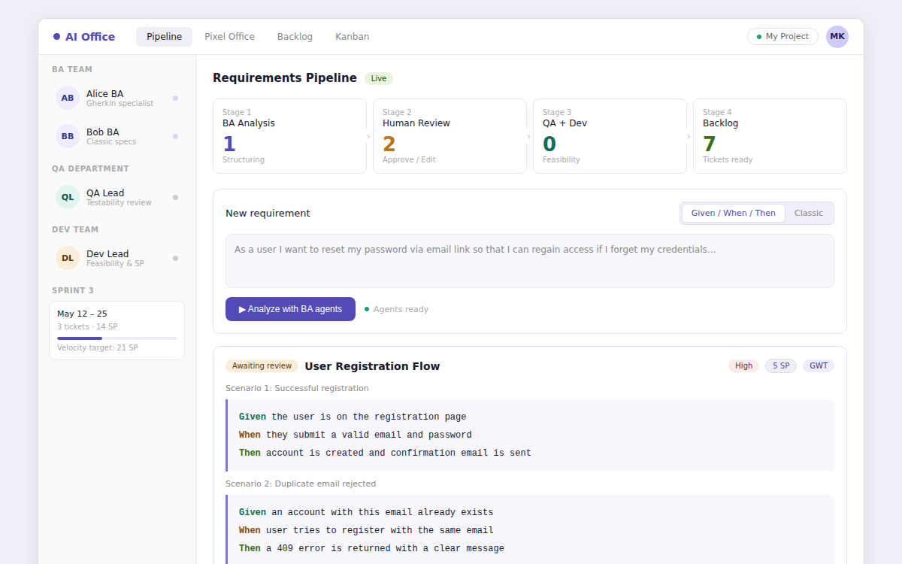
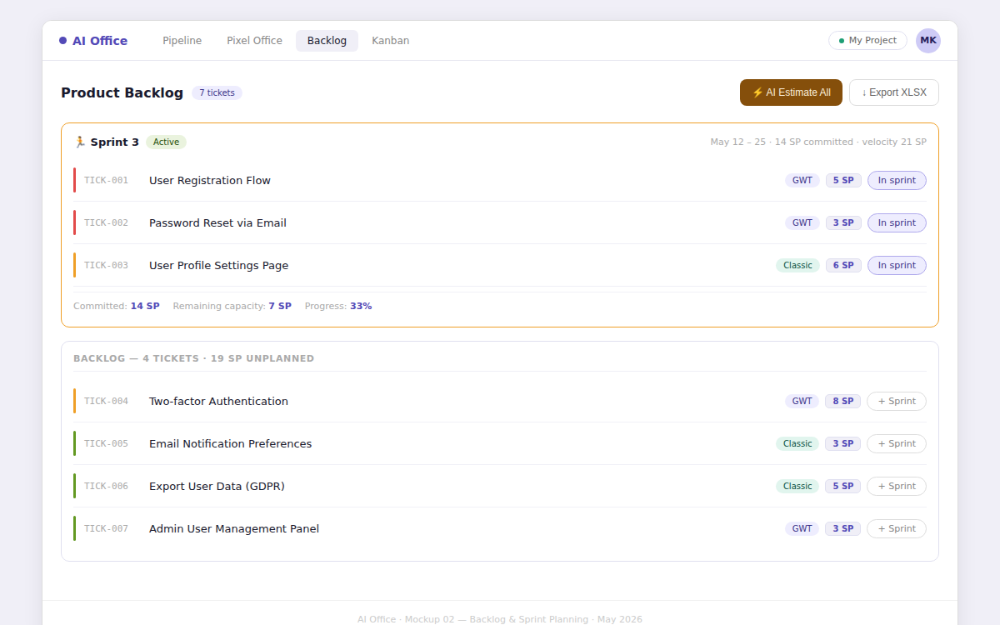
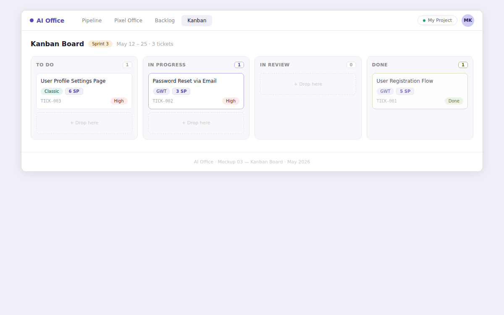
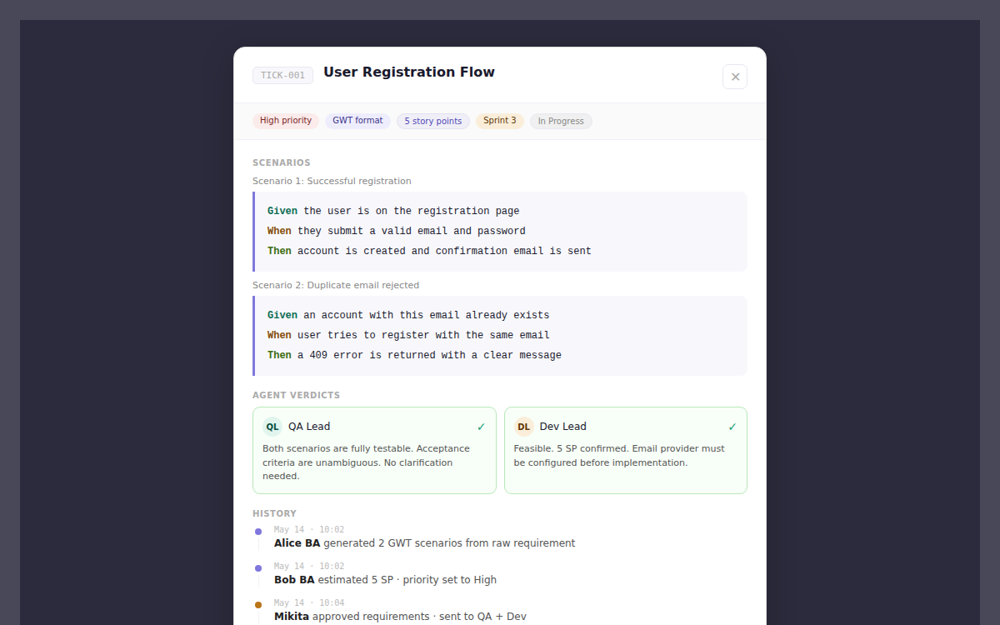
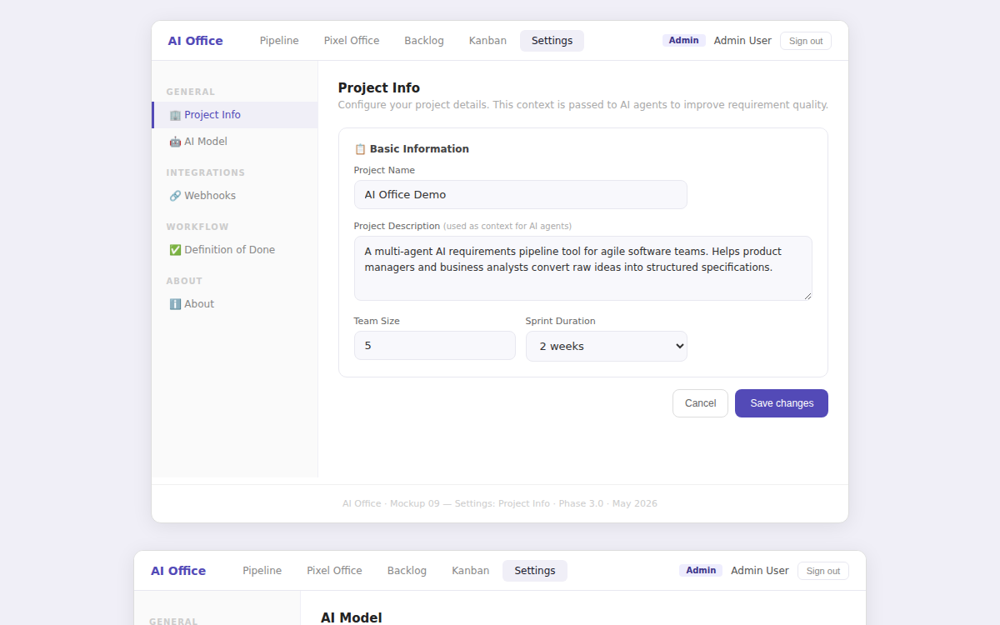
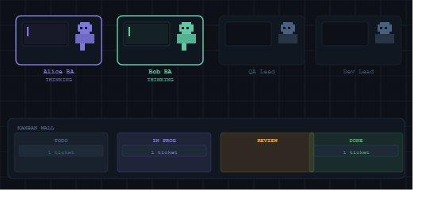

<div align="center">

# 🤖 AI Office

### AI-powered Requirements Pipeline Tool for Agile Teams

[](https://nextjs.org/)
[](https://react.dev/)
[](https://www.typescriptlang.org/)
[](https://tailwindcss.com/)
[](https://vercel.com/)
[](https://anthropic.com/)

</div>

---

## What is AI Office?

**AI Office** is an agile project management tool where AI agents do the heavy lifting — converting raw ideas into structured requirements, reviewing feasibility, generating test cases, and managing your sprint lifecycle automatically.

> **AI-First by design** — the AI agents *are* the team.
> BA, QA, and Dev agents handle analysis, review, and planning.
> Humans supervise and approve — they don't execute.
> Without the agents, there's no pipeline. That's the point.

Instead of spending hours writing specs and tickets, you type a requirement in plain language and a team of specialized AI agents (BA Lead, QA Lead, Dev Lead) analyze, structure, and validate it in seconds. The result lands directly on your Kanban board as a properly formatted User Story with acceptance criteria, test cases, and story point estimates.

Built for **Product Managers, Business Analysts, and Agile teams** who want to move faster without sacrificing quality. Works in English and Russian.

---

## Screenshots

### Requirements Pipeline — BA Agents in action

> Type a requirement, BA agents convert it to GWT (Gherkin) or Classic (FR/NFR/AC) format. QA and Dev agents review in parallel.



---

### Backlog & Sprint Planning

> Manage your backlog, plan sprints, track story points, and view resolved items from closed sprints.



---

### Kanban Board — Sprint Lifecycle

> Drag-and-drop board with sprint controls. Create and close sprints directly from the board. Only in-sprint tickets are visible.



---

### Ticket Detail Modal — AI-generated content

> Every ticket includes: structured requirements, agent verdicts, auto-generated QA test cases, tech notes, and full activity history.



---

### Phase 3 Features — Bug Pipeline, Settings, Retrospective

> Bug Report Pipeline with severity classification, Settings page with model selector, Sprint Retrospective agent.



---

### Pixel Office — Animated AI Agents

> AI agents visualized as pixel art characters. They walk to workstations when analyzing requirements.



---

## Features

### 🔄 Requirements Pipeline
Convert raw ideas into structured requirements in seconds. Type in plain language (English or Russian), choose GWT (Given/When/Then) or Classic (FR/NFR/AC) format, and BA agents generate a full spec automatically.

### 🐛 Bug Report Pipeline
A dedicated input mode for bug reports. Describe the bug in plain language — BA agent structures it with severity classification (Critical/Major/Minor), steps to reproduce, expected vs actual behavior.

### 🤖 Multi-Agent AI Review
After BA analysis, QA Lead and Dev Lead agents run **in parallel** to check testability and technical feasibility. If issues are found, BA agent revises automatically. Human approves or overrides.

### 📋 Kanban Board
Drag-and-drop board with 4 columns (Todo → In Progress → Review → Done). Only tickets assigned to the active sprint appear on the board.

### 🏃 Sprint Lifecycle Management
Full sprint lifecycle directly from the Kanban board:
- **Create Sprint** — name, start/end dates, smart defaults
- **Close Sprint** — confirmation modal with velocity summary; Done tickets move to Resolved Items, unfinished tickets return to backlog
- **Resolved Items** — collapsible section in Backlog showing all historically completed tickets grouped by sprint

### 🧪 QA Test Cases
Auto-generated when tickets move to In Progress. Manual generation available anytime in the TicketModal Test Cases tab. Works for both User Story and Bug tickets. Export to XLSX.

### 📝 Dev Tech Notes
On-demand technical implementation notes: proposed stack, implementation steps, edge cases, patterns to use. Generated by Dev agent for any User Story ticket.

### 🎯 MoSCoW Prioritization
AI-powered backlog prioritization using Must Have / Should Have / Could Have / Won't Have. BA agent analyzes all tickets in context of the project description from Settings.

### 🔄 Sprint Retrospective Agent
After closing a sprint, one click generates a full retrospective report: velocity, revision rate, what went well, blockers, suggestions for next sprint.

### ✅ Definition of Done
Configurable checklist that must be completed before a ticket can move to Done. Items configured in Settings.

### 🌐 Auto-Translation
Write requirements in Russian — auto-translated to English before BA analysis. Translation uses Haiku model regardless of selected model, keeping costs minimal.

### ⚙️ Settings Page
- Claude model selector (Haiku for speed, Sonnet for quality)
- Project name and description (used as AI context)
- Webhook integration (Jira / Azure DevOps)
- Definition of Done checklist configuration
- About section with dynamic build version

### 🎮 Pixel Office
Animated pixel art visualization of your AI agent team. Agents physically walk to workstations when analyzing requirements. Real-time activity feed. Full-screen mode.

### 🔐 Multi-user Auth
Login/register with project-scoped data isolation. Each user's tickets, sprints, and backlog are completely separate.

---

## How AI Agents Work

```
User types requirement
        ↓
  BA Agent (Alice or Bob)
  Analyzes & structures into GWT or Classic format
  Generates title, scenarios, story points, priority
        ↓
  QA Lead + Dev Lead (parallel)
  QA: checks testability, flags ambiguous criteria
  Dev: checks feasibility, identifies blockers
        ↓
  Issues found? → BA revises automatically
  No issues?   → Human approves
        ↓
  Ticket created → lands in Backlog as User Story
        ↓
  Added to Sprint → appears on Kanban board
        ↓
  Moved to In Progress → QA generates test cases
        ↓
  Dev clicks Generate Tech Notes → implementation plan
        ↓
  Sprint closed → Done tickets archived in Resolved Items
```

All agent calls route through a secure server-side proxy (`/api/agents`). Your Anthropic API key never reaches the browser.

---

## Tech Stack

| Layer | Technology | Purpose |
|-------|-----------|---------|
| Framework | Next.js 14 | App router, API routes, SSR |
| UI | React 19 + TypeScript | Component tree, type safety |
| State | Zustand + persist | Global state, localStorage persistence |
| Drag & Drop | @dnd-kit/core | Kanban drag-and-drop |
| Styling | Tailwind CSS | Utility-first styling |
| AI | Anthropic Claude API | All AI agent calls |
| Default model | claude-haiku-4-5-20251001 | Fast, cost-efficient analysis |
| Export | SheetJS (xlsx) | XLSX export for test cases |
| Visualization | HTML5 Canvas | Pixel Office rendering |
| Deploy | Vercel | Edge deployment |

---

## Getting Started

```bash
# 1. Clone the repository
git clone https://github.com/MikitaZhyhadla/ai-office
cd ai-office

# 2. Install dependencies
npm install

# 3. Configure environment
cp .env.example .env.local
# Open .env.local and add your ANTHROPIC_API_KEY

# 4. Start the dev server
npm run dev

# 5. Open in browser
open http://localhost:3000
```

Get your Anthropic API key at [console.anthropic.com](https://console.anthropic.com).

---

## Test Credentials

| Username | Password | Role |
|----------|----------|------|
| admin | demo1234 | Admin |
| qa_lead | test5678 | QA |
| dev_lead | dev9999 | Developer |

---

## Project Structure

```
src/
├── agents/                   # AI agent functions
│   ├── callAgent.ts          # Shared proxy fetch + retry + JSON parse
│   ├── baAgentGWT.ts         # BA agent: GWT format
│   ├── baAgentClassic.ts     # BA agent: Classic format
│   ├── baAgentRevise.ts      # BA agent: revision loop
│   ├── bugAgent.ts           # BA agent: bug report structuring
│   ├── qaAgent.ts            # QA agent: testability check
│   ├── devAgent.ts           # Dev agent: feasibility check
│   ├── qaTestCaseAgent.ts    # QA agent: test case generation
│   ├── devTechNotesAgent.ts  # Dev agent: tech notes generation
│   └── retroAgent.ts        # BA agent: sprint retrospective
│
├── app/                      # Next.js app router pages
│   ├── page.tsx              # Pipeline page
│   ├── backlog/page.tsx      # Backlog + sprint planning
│   ├── kanban/page.tsx       # Kanban board
│   ├── office/page.tsx       # Pixel Office
│   ├── settings/page.tsx     # Settings
│   └── api/agents/route.ts   # Anthropic API proxy
│
├── components/
│   ├── pipeline/             # RequirementInput, ReviewCard, RevisionBanner
│   ├── backlog/              # SprintPanel, TicketRow, ResolvedItemsSection
│   ├── kanban/               # KanbanBoard, KanbanCard, SprintControls
│   └── shared/               # Topbar, TicketModal, TestCasePanel, AgentToast
│
├── store/
│   ├── useAppStore.ts        # Main Zustand store (tickets, sprints, agents)
│   ├── usePipelineStore.ts   # Pipeline state persistence
│   └── useSettingsStore.ts   # Settings persistence
│
├── types/index.ts            # All TypeScript interfaces
└── lib/parseJson.ts          # stripJsonFences utility
```

---

## Roadmap

### ✅ Phase 1.0 — MVP
- Requirements Pipeline (GWT + Classic format)
- BA, QA, Dev agent analysis
- Basic Kanban board (4 columns)
- Backlog with sprint planning
- Story point estimation
- Pixel Office visualization

### ✅ Phase 2.0 — Advanced Features
- BA Revision Loop (auto-revision when QA/Dev flag issues)
- Ticket Detail Modal with full history timeline
- Pixel Office v2 (animated agents, BFS pathfinding, full-screen)
- QA Test Cases auto-generated on move to In Progress
- XLSX export for test cases
- Multi-user authentication with session management
- Manual ticket creation directly in Backlog

### ✅ Phase 3.0 — Intelligence & Integration
- Settings page (model selector, project info, webhooks, DoD)
- Bug Report Pipeline with severity classification and red badge
- Dev Tech Notes — on-demand technical specs in TicketModal
- MoSCoW Smart Prioritization — AI prioritizes full backlog
- Sprint Retrospective Agent — velocity, blockers, suggestions
- Definition of Done checklist — configurable, blocks Done moves
- Auto-translation — Russian → English before BA analysis
- Webhook integration — push tickets to Jira / Azure DevOps
- Pipeline state persistence (survives navigation)
- Agent activity toast with timeout warnings

### ✅ Phase 3.x — Sprint Lifecycle (current)
- **Create Sprint** from Kanban board with smart defaults
- **Close Sprint** — confirmation modal with velocity summary
- **Resolved Items** section in Backlog, grouped by sprint
- Kanban board shows only in-sprint tickets

### 📋 Phase 4.0 — Team & Collaboration (planned)
- Real-time multiplayer (multiple users editing simultaneously)
- Comments and @mentions on tickets
- Slack / Teams notifications
- Velocity and burndown charts
- Advanced analytics dashboard
- Custom agent personas
- Public API for external integrations
- Role-based access control (BA / QA / Dev / Admin)

---

## Environment Variables

| Variable | Required | Description |
|----------|----------|-------------|
| `ANTHROPIC_API_KEY` | ✅ Yes | Your Anthropic API key from console.anthropic.com |

---

## Contributing

1. Fork the repository
2. Create a feature branch: `git checkout -b feature/your-feature`
3. Commit your changes: `git commit -m "feat: description"`
4. Push to the branch: `git push origin feature/your-feature`
5. Open a Pull Request

---

<div align="center">

Built with ❤️ using [Next.js](https://nextjs.org/) + [Anthropic Claude](https://anthropic.com/)

</div>
